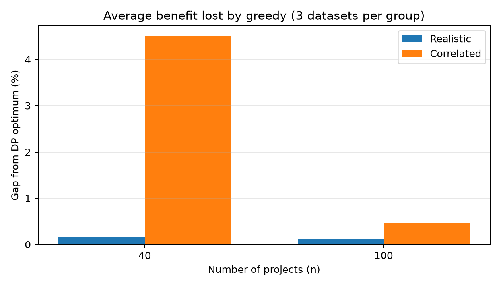

# Results and Rec

After comparing greedy's benefit to cost with dynamic programming I found that greedy's average gap was around 4.5% at around 40 projects. When the number of projects increased though to 100 the gap became much smaller at around .47%. Still though dynamic programming performed better overall on these tests so I would recommend that. However if you need a faster approximate answer then I'd say greedy is better because its much faster compared to dynamic programming when the projects increase since dynamic programming's memory increases much more quickly.

# Problem

A city has a budget and a list of projects to be funded. Each project has a cost and benefit and I have to find the best benefit to cost ratio from that that doesn't exceed the budget. The input is the budget, the projects, and the project Ids, cost, and benefit. The algorithms return a list of project Ids. To compare the algorithms too I looked at their total benefit and time.

# Algorithms

Greedy sorts by n=benefit to cost from highest to lowest and checks them in that order and add projects that fit the budget. Sorting the projects take O(n log n) time. The space once again is O(n).

Dynamic Programming finds the best combination that has the highest benefit and at each project check, it checks the benefit that each combination in it can have. It takes O(nB) time as well as space where n is the number of projects and B is the budget. So as the projects or budget grows, so does the algorithms time and space complexity which means it gets slower with bigger numbers compared to greedy.

# Test Envrionment

I used a Macbook M1 with 8 gigs of ram on macOS version 27.0.1 and Python 3.12.10 in a venv.

# References

- `P3_Project_Brief.docx`: problem requirements and algorithm assignments
- `starter/` code: input loader and correctness checker
- `data/` files and generator: project datasets